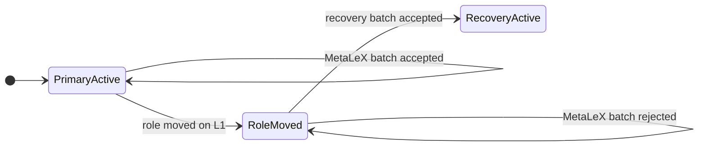
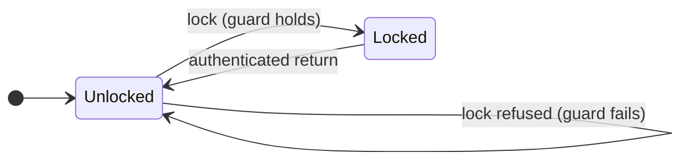

# MetaLeX private-chain plan: invariant review

The requirements in MetaLeX's private-chain plan do not contradict each other. Three points are open: the plan states the requirement but leaves the rule that meets it undecided. This page quotes each requirement, shows the state transition it governs, and names the decision MetaLeX must make.

## Source and method

**Source.** MetaLeX Engineering, *Build MetaLeX's private chain with recovery*, standalone edition, "Evidence as of 08 November 2026". Citations below give the plan's section heading and table number. Every quotation is verbatim. Vendor quotations come from the linked ZKsync and L2BEAT pages, read 9 November 2026.

**Method.** Armada extracted 65 invariants from the plan and checked each pair against the plan's state machine. That state machine has three participants, not two: MetaLeX as primary operator, the independent recovery operator, and the settlement contract on Ethereum. A pair counts as a conflict only if no state of that machine satisfies both. No pair does.

**Open point.** A requirement is open when the plan states what must hold, but does not fix how. The rule, the role or the guard that makes it hold is missing. An open point is a decision, not a defect.

**Invariant IDs.** The IDs (I-n) come from Armada's extraction, and match `invariants.md`. The plan does not number its invariants.

## Summary

| # | Requirement | What the plan leaves open | Who decides |
|---|---|---|---|
| 1 | Fencing and promotion without MetaLeX (I-45, I-46) | The L1 role that holds submission authority, and the rule that moves it to the recovery operator | MetaLeX, with the recovery operator |
| 2 | No collateral movement while public wrappers exist (I-19, I-20) | The guard that decides which assets may enter the bridge in production | MetaLeX, for each instrument class |
| 3 | "Contract rights do not depend on a Prividium login" (I-5) | Whether the sentence is about how rights are defined, or about whether a holder can always use them | MetaLeX |

## Open point 1: the rule that moves submission authority

### The requirements

| ID | Requirement | Plan text | Location |
|---|---|---|---|
| I-45 | Fencing | "The selected settlement/operating mechanism must revoke or supersede the old sequencer/proposer/submission authority and demonstrate that two operators cannot continue conflicting operation." | §3, "P2 recovery is operational; P3 adds enforceable departure" |
| I-45 | Not by network failover | "DNS failover is insufficient." | Same section |
| I-46 | Promotion without MetaLeX | "If promotion requires an unavailable MetaLeX signature or discretionary vendor permission, independent recovery has failed." | Same section |
| I-12 | The recovery operator's powers | "The recovery vault needs infrastructure authority, never user transaction keys." | Same section |

### The state transition

The settlement contract on Ethereum holds the submission authority. It accepts a batch only from the holder of that role. Promotion is one L1 transaction that moves the role from MetaLeX to the recovery operator. After that transaction, the contract rejects MetaLeX's batches. So the move itself fences the old writer, and two writers cannot both settle.

"Role moved on L1" is one L1 transaction under a rule fixed in advance. I-45 and I-46 both hold if the rule that moves the role does not need MetaLeX's signature. For example:

- the recovery operator holds a key that may move the role; or
- the role moves to the recovery operator when no batch settles for a fixed time.

### What the plan leaves open

The plan requires the result but does not name:

- which L1 role holds submission authority on the selected stack;
- who may move that role, and under which rule;
- whether that rule is already available on the selected release, or needs a change.

The plan's P0 asks for "independent operating rights", which is where this decision belongs.

### A separate point that is not a conflict

The plan also says: "With only MetaLeX and one recovery operator, requiring both also gives either party a liveness veto." This sentence is about the gate on data delivery: whether each batch waits for the recovery operator's acknowledgment before it settles. It is a stated trade-off between waiting and not waiting. It does not affect who may submit batches, so it does not interact with fencing.

## Open point 2: the guard on entry to the bridge

### The requirements

| ID | Requirement | Plan text | Location |
|---|---|---|---|
| I-2 | Preserve the protocol semantics | "Preserve CyberCorp authority, LET legal-owner/custody distinctions, agreement identities, escrow obligations, scrip accounting and recertification rules." | §1, "One EVM protocol architecture is a fixed requirement" |
| I-19 | No collateral movement while wrappers exist | "Disable optional force-transfer/force-burn features for this candidate asset: they must not destroy or move collateral while public wrappers remain outstanding." | §2, "Why the first bridge locks canonical scrip" |
| I-20 | The wrapper has its own policy | "A private holder limit or whitelist does not automatically constrain the public wrapper; whitelisting the bridge address alone merely sees one private holder." | Same section |
| I-20 | The policy must be explicit | "Define freeze handling and the wrapper's public transfer policy explicitly." | Same section |
| — | Upgrades can change the guard | "Beacon upgrade powers can change these assumptions later and belong in the powers review." | Same section |

### The state transition

Force-transfer and force-burn are optional features. Whether an asset enables them is configuration, not protocol semantics, so disabling them does not touch I-2. I-19 is then a guard on the lock transition: canonical scrip may enter the bridge escrow only from an asset whose force features are off.

The guard holds when the asset's force features are off and the wrapper's transfer policy is defined. I-20 is not a constraint on the private asset. The wrapper is a separate token, and the plan requires its transfer policy to be defined on its own.

### What the plan leaves open

The plan states the guard for one asset only: the P1 candidate, which uses "fresh, homogeneous, fully paid synthetic LETs and a 1:1 base-unit ratio". For production it does not say:

- which instrument classes may enter the bridge;
- where the guard is checked: in the bridge escrow, in the issuer's configuration, or in operations;
- what happens to outstanding wrappers if a beacon upgrade later turns a force feature back on.

If an issuer needs force actions or holder restrictions to reach wrapped holders, that is new scope. The plan lists it in Table 08 as "Extended restriction/force-action synchronization", for separate approval.

## Open point 3: the meaning of the login sentence

### The requirements

| ID | Requirement | Plan text | Location |
|---|---|---|---|
| I-5 | Rights do not depend on a login | "Contract rights do not depend on a Prividium login" | §1, Table 02, row "Privacy and data access", column "Portable protocol requirement" |
| — | Private access enforcement | "Private RPC/policy enforcement and scoped indexers on Prividium" | §1, Table 02, same row, column "Chain-specific configuration or adapter" |
| I-10 | Authority stays in the contracts | "Keep corporate authority in BorgAuth, the company/managers and user signatures." | §1, "Default to Core; buy Commander only for demonstrated operating value" |
| I-40 | Fail closed | "fail closed on private-chain authentication failure" | §4, "Adapt actual application transports and call paths" |

### Two readings

**Reading A: the contracts define rights without a login.** No contract check takes the login as an input. The gateway is an adapter in front of the contracts. The plan's layout supports this reading: Table 02 puts the sentence in the column "Portable protocol requirement" and puts the gateway in the column "Chain-specific configuration or adapter". Under this reading, nothing more is needed.

**Reading B: a holder can always use the rights that the contracts record.** On the selected stack, every request passes the gateway:

> "All interactions — from users, enterprise applications, block explorers, or bridge operations — must pass through this proxy."
>
> — ZKsync Docs, [Prividium™ Architecture](https://docs.zksync.io/zk-stack/prividium/architecture)

The gateway fails closed (I-40), and the operator can filter transactions that come from L1 ([ZKsync Docs, Transaction filtering](https://docs.zksync.io/zk-stack/customizations/transaction-filtering)). L2BEAT records that ZK Stack users "can submit transactions to an L1 queue, but can't force them" ([L2BEAT, ZKsync Era](https://l2beat.com/layer2s/projects/zksync-era)). So reading B needs a forced-inclusion path for writes, which the plan does not have.

### What the plan leaves open

Which reading MetaLeX intends. Table 07 lists "censorship" among the operator powers for legal review, which fits reading A.

## Pairs that look like conflicts

| Pair | Why it is not a conflict |
|---|---|
| Two named plaintext audiences (I-35) against fencing and promotion without MetaLeX (I-45, I-46) | The L1 settlement contract is a third participant. It holds the submission role, so it fences and promotes without a vote between the two operators (open point 1). |
| Preserve the protocol semantics (I-2) against no collateral movement while wrappers exist (I-19) | Force features are optional configuration. Turning them off is a guard on the lock transition, not a change to the protocol (open point 2). |
| No rollback past a public bridge obligation (I-42) against no loss of finalized obligations (I-43) | Bridge messages wait for source finality (I-32). P2 "should operationally gate" settlement on the recovery operator's acknowledgment, so a bridge obligation then refers to a block that the recovery operator holds. The plan notes that "MetaLeX could bypass its own software gate", so this holds while the gate holds. |
| Retire the issuer's epoch on the source (I-60) against departure without the first operator (I-46) | The proposed `IssuerEpochRegistry` can sit on L1, where the first operator cannot block it. The plan does not yet fix its location. |
