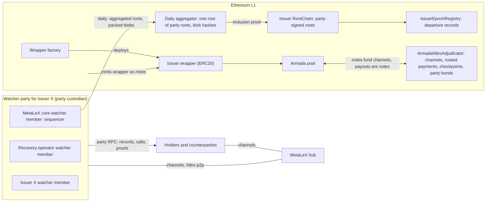
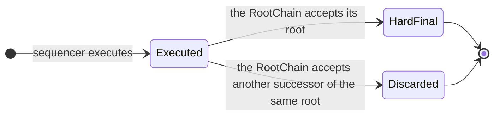

# MetaLeX on Armada: system design

Status: draft for review, 2026-11-09. Not built.

MetaLeX's Cybercorps contracts run unchanged, but not on one shared chain. Each issuer gets its own EVM state, the *issuer state*. A small group of operators, the issuer's *watcher party*, runs that state. The group has three *watcher members*: MetaLeX, an independent recovery operator, and the issuer.

Once a day, the watcher party posts a fingerprint of the state, its *root*, to an Ethereum contract: the issuer's *RootChain*. Each holder keeps proofs of its own records against those roots. So a holder can show what it owns, even if every operator fails.

Money does not live in the issuer state. It stays in *armada-nitro*, Armada's payment system on Ethereum. There, value is either a shielded *note* in the Armada pool, or a balance in a payment *channel* that a note funds. A buyer's USDC stays in the buyer's own channel until the deal settles. Scrip that leaves the issuer state becomes notes of an issuer-specific token, the issuer's *wrapper*.

The design has no zkEVM and no GPU prover, because proving every root costs too much to operate (§11). It relies on three other things instead:

- signed commitments that the operators cannot deny;
- proofs that each holder checks itself;
- a conservation proof that anyone can check.

Short citations such as `cc` or `mlx` refer to the sources at the end. `invariants.md` lists the requirements that this document holds. Terms follow `glossary.md`.

## 1. Requirements

1. Run the unchanged Cybercorps contracts.
2. Keep each issuer's records readable only by MetaLeX, the recovery operator and the issuer.
3. Let a holder prove its own MetaLeX assets against L1, and help itself if the issuer, MetaLeX and the recovery operator all fail.
4. Keep all value in armada-nitro: shielded notes and channels.
5. Let scrip leave the issuer state as armada-nitro notes, with MetaLeX's accounting.
6. Define every component as a typed state machine with guarded transitions. No fallback paths.
7. Let no party other than an asset holder start an action against that holder's assets.

## 2. Architecture

The parts of the system are on Ethereum L1, in each watcher party, or with MetaLeX.

**On Ethereum L1**

- **Issuer RootChain:** An L1 contract, one per issuer. It stores the hard-final roots of the issuer state, one successor per root, each accepted on the party signature (§6).
- **Daily aggregator:** An L1 contract. Once per day it records one Merkle root over every party's signed root, and the hashes of the blobs that carry their data (§6.2).
- **IssuerEpochRegistry:** An L1 contract that records each departure: the old RootChain's final root and the successor's identity (§5.5).
- **Issuer wrapper:** An ERC20 on L1, one per issuer, whose only minter is the party custodian. It is held as notes in the Armada pool (§10).
- **Wrapper factory:** The L1 factory that deploys each issuer's wrapper. A hub names it in its asset list (§10).

**Run by each watcher party**

- **Issuer state:** One EVM state per issuer: its Cybercorps companies, its channel-balance contract and its payout records (§3).
- **Watcher party:** An entity: the threshold signer that runs one issuer state and anchors it to L1. Through its custodian it is also an armada-nitro participant and the minter of the issuer's wrapper (§4).
- **Party custodian:** The watcher party's `HubCustodian`. It signs the watcher party's channel states and wrapper mints with the party key only, with no hot delegate (§4.1).
- **Party RPC:** The watcher party's own private RPC, in MetaLeX's sense. The only interface to the issuer state (§8.1).
- **Channel-balance contract:** A system contract in the issuer state with an ERC20 interface. Each balance is USDC that a holder committed to the watcher party in armada-nitro and has not yet withdrawn (§9.2).
- **Party bond:** One armada-nitro channel per watcher party (§4.4).

**Run by MetaLeX, or by anyone**

- **MetaLeX hub:** An armada-nitro hub, and an entity distinct from MetaLeX, the company. As MetaLeX core it is a watcher member of every party. MetaLeX is a plaintext audience through it. It routes payments, runs watchtowers for website users, and supplies user IDs to each issuer state (§8.1, §9).
- **Verifier tool:** A tool that reads a root and the wrapper's supply from L1, and checks the conservation proof against them (§11).

## 3. Issuer state

**Contents.** One EVM state per issuer holds the issuer's Cybercorps companies: CyberCorp, BorgAuth, IssuanceManager, LETs, scrip, agreements, deals, rounds, LexScrow and MetaVesT. It also holds the channel-balance contract and the payout records (§9). Every asset in it is one that the issuer's watcher party issues. The USDC behind each balance stays in armada-nitro.

**Which companies share one state.** `ParentCoFactory.deployCorp` deploys a CyberCorp. `ParentCoFactory.deployCorpContractFor` deploys a CyberCorp and signs its agreements in the same transaction (`cc` `src/ParentCoFactory.sol`). Which companies share one issuer state is a deployment parameter, to be settled with MetaLeX.

**Execution.** Each watcher member runs the state in the nimbus EVM, embedded in its harness, from one pinned commit of Armada's nimbus-eth1 fork (`nimbus`). The harness fixes these values:

| Value | Rule |
|---|---|
| `chainid` | Unique per issuer, never used by a public chain. EIP-712 domains therefore never collide. |
| Hardfork and precompiles | One pinned spec that matches MetaLeX's compiler target |
| `timestamp` | Set by the sequencer, bounded by the timestamp of a recent L1 block. Cybercorps reads it for expiries, deadlines and holding periods. |
| `number`, `prevrandao`, `coinbase`, `basefee`, `BLOCKHASH` | Fixed by the harness. Cybercorps reads none of them: `src/` reads only `block.timestamp` and `block.chainid` (`cc`). |

**Why the nimbus EVM.** Armada's client already runs nimbus on every target. The verified proxy builds natively, as `libverifproxy.a` for iOS and Android, and as WASM (`adr` ADR-0009). The nimbus EVM is Nim in the same codebase. So the harness, the mobile app's watcher and the browser verifier run one EVM and one runtime, beside the light client they already contain. The nimbus EVM executes against an in-memory ledger, as the verified proxy's `eth_call` does (`nimbus` `execution_chain/evm/async_evm.nim`).

**State tree.** The harness does not use nimbus's own Merkle Patricia trie for the root. After each block it reads the changed slots from the ledger and commits the state in a Jellyfish Merkle Tree (JMT). A JMT is a 256-bit binary sparse Merkle tree in which empty and single-leaf subtrees collapse, so a proof has about log₂(number of keys) hashes. It proves inclusion and non-inclusion. The tree is blinded:

| Part | Rule |
|---|---|
| Position | `H(positionSalt ‖ address ‖ slot)`. The position salt is fixed per slot. |
| Leaf | `H(value ‖ salt)`, with a fresh random salt each time the value changes |
| Hash | Pluggable per deployment. Default SHA-256 (§13). |

**Events.** Besides the state root, each batch commits to `eventsRoot`: every log of the batch, in order. It is the same commitment as Ethereum's `receiptsRoot` and Starknet's `event_commitment`. Holders read their history from it (§8).

## 4. Watcher parties

A watcher party is a bonded group of operators, in the sense of Armada's glossary (`t2`). In this design, each watcher party serves one issuer. It runs the issuer's state and anchors it to Ethereum. It is also an armada-nitro participant: it holds channels, receives payments and pays withdrawals.

### 4.1 Composition

Each issuer has one watcher party, and MetaLeX's whole platform is the set of these parties. A watcher party has three watcher members: MetaLeX core, the recovery operator and the issuer (n = 3). MetaLeX core is the MetaLeX hub in its role as a watcher member of every party. It sequences by default, and MetaLeX is a plaintext audience through it.

**Keys.** Each party has one FROST threshold key, the *party key*. Its threshold t is a two-thirds majority of n, a parameter of the deployment. With n = 3, t = 2. So any two watcher members can sign, and no signing set needs MetaLeX's share.

**Custodian.** On L1, the party acts through its *party custodian*: a `HubCustodian` under the party key (`nitro` `src/HubCustodian.sol`; `adr` ADR-0016 D16.2). It is the party's EIP-1271 identity in its channels, and the only minter of the issuer's wrapper. It signs every channel state with the party key, and it has no hot delegate. A hot delegate would only save signing time. Roots finalize daily, so a threshold signature on each state costs no time that matters.

**Liveness.** The system's liveness never depends on the MetaLeX hub: any t watcher members continue the RootChain and the pay-outs without it. With n = 3 and MetaLeX core down, an issuer's RootChain advances only while that issuer's watcher member is up.

### 4.2 Duties

1. **Sequence and execute** the issuer state. MetaLeX core does this by default.
2. **Sign hard-final roots** with the party key (§6). A watcher member contributes its signature share only after it stores the batch durably, so at least t watcher members hold every hard-final batch.
3. **Publish** each batch's blinded tree data in blobs (§7).
4. **Keep the channel balances:** apply each co-signed state from Nitro p2p in its next batch. Pay each withdrawal through armada-nitro once its batch is hard final (§9.2). Mint and burn the issuer's wrapper (§10).
5. **Publish a conservation proof** for each hard-final root (§11).
6. **Run the party RPC**, which serves each holder its records, salts and proofs (§8.1).

### 4.3 Storage

Each watcher member stores the full state and history itself: every block, receipt, log, salt and position salt. L1 does not rebuild a watcher member's state, because the blobs are blinded. A party continues as long as t of its watcher members hold the state.

### 4.4 Bond

Each party bonds through one armada-nitro channel. Its participants are the party custodian and a slashing arbiter. The arbiter is an EIP-1271 participant that signs only a state with a valid fault proof. So no one can slash the bond without such a proof. The watcher members fund the bond, and how they share a slash is their own agreement.

| Fault | Slashable | Proof |
|---|---|---|
| The party key signs two different successors of the same root | Yes | Two signatures from the party key, over two roots with the same `prevRoot` |
| A watcher member leaks plaintext | No | A leak does not identify the leaker. It stays a legal obligation. |

## 5. State machines

Each component is a typed state machine. Each target state has exactly one entry transition, with its guard. A transition whose guard fails reverts and changes nothing. There are no fallback paths.

### 5.1 Batch

| Transition | Guard |
|---|---|
| Executed → HardFinal | The RootChain accepts the batch's root (§6.1) |
| Executed → Discarded | The RootChain accepted a different successor of the same `prevRoot` |

Only a hard-final batch affects anything outside the issuer state. Such effects are a payment out of a withdrawal, a wrapper mint, a departure, or a proof given to a holder as final.

### 5.2 RootChain

| State | Entry transition | Guard |
|---|---|---|
| Live | Deployment | — |
| Retired | `finalizeDeparture` on `IssuerEpochRegistry` (§5.5) | The RootChain is at its final root. It accepts no further roots. |

An issuer with no transactions posts nothing.

### 5.3 Payment

| State | Entry transition | Guard |
|---|---|---|
| Committed | The buyer and the watcher party co-sign a state in the buyer's channel that moves the amount from the buyer's allocation to the watcher party's | An ordinary armada-nitro payment: the buyer's latest co-signed state allocates at least that amount to the buyer |
| Credited | The watcher party applies the co-signed state in its next batch. The channel-balance contract credits the buyer, and the batch records the state's hash. | A Committed state not yet applied |
| Withdrawn | The holder calls `withdraw` on the channel-balance contract, and its balance falls by the amount | The holder's own transaction, against its own balance |
| Paid | The watcher party pays the amount to the holder through armada-nitro, and the issuer state records a payout record | The withdrawal's batch is hard final, and the withdrawal has no payout record yet |

### 5.4 Scrip lock

| State | Entry transition | Guard |
|---|---|---|
| Locked | `lock` in the issuer state, naming the holder's note key | The entry guard: `canForceTransfer()`, `canForceBurn()` and `canFreeze()` all return false, `transferRestrictionHooksLength()` is zero, and the asset's implementation hash equals the pinned hash. CyberScrip's `disable…` functions are one-way: "Cannot be re-enabled post-initialization" (`cc` `src/CyberScrip.sol`). |
| Wrapped | The party custodian mints the same amount of wrapper and shields it as a note to the named key | The lock's batch is hard-final, and the lock is not yet wrapped |
| Returned | The holder pays wrapper back to the party custodian, which burns it | The token is the issuer's wrapper |
| Unlocked | The watcher party unlocks the scrip to the holder in the issuer state | A Returned amount not yet unlocked |

`setRestrictionHook` stays callable after a lock (`cc` `src/CyberScrip.sol:146-149`). A hook added later that blocks an unlock is a misaccounting, and the signed lock and return records are the holder's evidence (§11).

Each lock and return record binds the bindings of `mlx`'s `BridgeMessageV1`: issuer (`chainid`), epoch, direction, asset, holder, note key, amount, nonce and source event. `mlx` §2's six statuses map onto the states:

| `mlx` status | Here |
|---|---|
| submitted | The lock or return transaction is sent |
| included | The lock is in a batch |
| source-finalized | The lock's batch is hard-final |
| message-proven | Not used: no public gateway proves a message. The watcher party's signed mint or unlock record takes its place. |
| destination-executed | Wrapped (out) or Unlocked (in) |
| recovery-protected | The records are in the watcher members' stores and in the holder's own store |

### 5.5 Issuer epoch

| State | Entry transition | Guard |
|---|---|---|
| Active | Deployment | — |
| Retiring | `scheduleDeparture` on `IssuerEpochRegistry` | Signed by the party key. The successor's watcher party checks `mlx` §3's scope rules (settled deals, drained escrows, no reserved units, resolved allocations) before it accepts the state. |
| Retired | `finalizeDeparture` | Signed by the party key. It records the old RootChain's final root and the successor's identity, and the old RootChain accepts no further roots. |

No import happens on L1. The successor's watcher party receives the full state from the old watcher members, the MetaLeX hub included. Each holder proves its own records to the successor from its own store, against the final root. Every wrapper note, pending lock or return, and channel balance gets one disposition in the successor's state.

## 6. RootChain rules

### 6.1 Root acceptance

The RootChain accepts a root, directly or by inclusion proof from the daily aggregator (§6.2), only if all of these hold:

1. **One successor.** `prevRoot` equals the last hard-final root, and `height` is the last height plus one.
2. **Party signature.** The party key signed `(prevRoot, newRoot, height, batchCommitment, eventsRoot, chainConfigHash, blobRefs)`.
3. **Blob binding.** `blobRefs` lists the versioned hashes of the blobs that carry this party's data, with its offset and length in each. Every hash is one that the aggregator recorded as published, or one in the root's own blob transaction.

The RootChain only stores roots. It checks no validity proof (§11) and acts on no message.

### 6.2 Daily aggregation

By default, MetaLeX core publishes all parties' roots of the day in one run:

1. **Blobs, packed by size.** The blob data of every party with changes is concatenated and split into blobs. One blob transaction holds up to Ethereum's per-transaction blob limit; a day that needs more uses more blob transactions.
2. **One aggregation call.** The first blob transaction calls the aggregator. It records the versioned hashes of the day's blobs and one Merkle root over the day's signed party roots.
3. **Lazy RootChain reads.** A RootChain reads its root from the aggregator by inclusion proof only when an L1 action needs it, for example a departure. Holders check the inclusion proof off chain (§8.2).

Each party still signs only its own root and its own blob references. A party with no changes is absent from the day's tree, and posts nothing. Any t watcher members of a party may submit their root directly to their RootChain, in their own blob transaction, by the same rules. That is the same transition, not a second path.

## 7. Blob data: blinded, not encrypted

Each root publishes, in blobs, the blinded position and blinded leaf of every slot whose value changed since the previous root. A slot that changed several times since the previous root appears once, with its final value. Interior nodes are not published: anyone with the archived leaves rebuilds the tree.

| Property | Result |
|---|---|
| Binding | The party signature names the blob hashes, offsets and lengths (§6.1) |
| Hiding | No key exists to steal or break. Learning a value needs a SHA-256 preimage that includes a 256-bit random salt. |
| What stays visible | How many leaves changed per batch, when, and the size of the tree. A slot's position salt is fixed, so an observer can see that the same position changed again in a later batch. |
| Who uses it | A holder that lost its own copy of its records, salts and proofs, or that got no update for a root (§8.2, §8.3) |
| What it does not do | Rebuild a watcher member's state. Watcher members store the state themselves (§4.3). |

Ethereum prunes blobs after about 18 days. Every watcher member archives the blob data, and anyone else may archive it too, because it reveals nothing. Each holder keeps its records, salts and latest proofs. Most holders use MetaLeX's website, which keeps them in browser storage. Holders who want durable records use Armada's mobile app, which contains the website and a watcher for the holder's own records. Browser storage holds the same data, but it is more easily deleted.

## 8. Holders

### 8.1 The party RPC

Each watcher party runs its own RPC, in MetaLeX's sense of the word: the private, authenticated endpoint that `mlx` puts in front of the chain ("Private RPC/policy enforcement", Table 02). It is the only interface to the issuer state. Any watcher member may run an endpoint of it. MetaLeX core runs one by default.

For each hard-final batch that changes a holder's records, the party RPC gives the holder:
- each changed value, its new salt and its position salt;
- the logs that touch the holder's records;
- a proof of each record against the new root.

A holder subscribes for these, or fetches them. Every item verifies against a root on L1.

**Authentication.** The issuer state gets user IDs from the MetaLeX hub. A user signs each request to the party RPC with its wallet key, through MetaLeX's existing wallet login (`mlx` §4: the Privy-aware wallet abstraction). The party RPC checks the signature against the ID in the issuer state, and scopes the request by the contracts' authority for that address (§8.4). The hub is not in the request path, so a user reads its records while MetaLeX core is down. Authentication establishes identity only. Rights stay in the contracts.

### 8.2 Verification

1. **Read the root** from the RootChain through a light client: Armada's nimbus verified proxy.
2. **Check each record** with the JMT verifier from `lib/`, compiled to WASM with the nimbus toolchain: the same Nim code that the harness runs.
3. **Check the code.** The same root commits to each contract's code hash. The holder decodes slots with the storage layout that MetaLeX's deployment manifest pins for that code hash.
4. **Check completeness** of its history: every change of value between consecutive roots must be explained by logs in `eventsRoot`.
5. **Check every new root.** The verifier checks each of the holder's records against each new hard-final root. If a proof fails and the party RPC delivered no update, the verifier reads that root's blobs to find the change (§7). The mobile app does this itself. The website does it while it is open.

So a holder detects any change to its own records, even when the party RPC is silent. It can also prove what it held at any root.

### 8.3 Self-help

The issuer, MetaLeX and the recovery operator can all fail. A holder then uses only L1 and what it holds in browser storage or in the app (§7):
- its values, salts and position salts from §8.1;
- the archived blob data, from which it rebuilds the tree.

From these it computes a proof of each record against the last root. That proof shows what the holder owned. If the issuer departs to a successor, the holder proves its records to the successor's watcher party with the same proof, off L1 (§5.5).

### 8.4 Scope

A holder sees its own records under the contracts' own authority: its LETs, scrip, channel balance, endorsements, agreements and grants. It sees an asset's history only from the batch in which it first holds the asset. Earlier holders are other counterparties of the issuer, and no counterparty sees another counterparty's private data. Issuer officers see every counterparty's data. MetaLeX, through the MetaLeX hub, and the recovery operator see everything, as the named plaintext audiences.

### 8.5 Methods and writes

The party RPC serves MetaLeX's app with `eth_sendRawTransaction`, `eth_getTransactionReceipt`, `eth_call` and `eth_getLogs`, each scoped by the contracts' authority (§8.4, `mlx` §4, A1). It adds methods for records, salts, proofs and history subscription. It has no unscoped method.

Writes go to the sequencer. Before sequencing, the harness executes each transaction with an inspector that checks every CALL, DELEGATECALL and CREATE frame against the policy. A transaction with a denied frame is not included.

The sequencer can also refuse a write. A payer whose write is refused gets no asset and has no remedy on L1. Its signed request and the refusal are its evidence to MetaLeX.

### 8.6 The web app's endpoint and indexing

MetaLeX's web app needs no new transport. The work splits between the party RPC and the browser:

| Part | Where it runs |
|---|---|
| A standard JSON-RPC endpoint for each issuer's `chainid`, so the app's contract calls stay unchanged | The party RPC, on the endpoints that watcher members run. The MetaLeX hub is not in the request path. |
| The watcher party's own index: logs, history and records, scoped by the contracts' authority | The party RPC. The app needs no public indexer. |
| The signature on each request (§8.1) | The browser, through the user's wallet |
| Verification of each record against the issuer's root on L1 (§8.2), failing closed when a check or the authentication fails | The browser, through the WASM verifier and Armada's browser light client |

The app's one new step is the payment in armada-nitro, which the user's Armada wallet co-signs (§9.2).

## 9. Value

### 9.1 Where value lives

All value is armada-nitro assets on L1: shielded notes in the Armada pool, and channels funded from notes that pay out to notes.

| Property | Source |
|---|---|
| A channel is funded from a note. The collateral stays in the pool as an adjudicator-owned commitment. | `nitro` `ArmadaNitroAdjudicator.depositFromNote`, `src/ArmadaNitroAdjudicator.sol:91` |
| A payout mints fresh SHIELD notes in the pool | `nitro` `src/ArmadaNitroAdjudicator.sol:144, 159` |
| No counterparty can take funds: every outcome needs the holder's latest signed state | ForceMove |
| A hub is trusted for liveness only | `adr` ADR-0015/0016, ADR-0021 |

Funding a channel needs a working hub: MetaLeX's or an issuer's.

**Watchtowers.** ForceMove protects a channel only if someone answers a stale-state challenge within the challenge window. The MetaLeX hub runs a watchtower for website users by default. The recovery operator may also run one. The mobile app runs its own.

### 9.2 The watcher party as a Nitro participant

The Cybercorps contracts pull, hold and pay an ERC20 in the same EVM (`cc` `src/storage/LexScrowStorage.sol:251, 308`). The USDC itself stays in armada-nitro. So the issuer state gets a view of it: the *channel-balance contract*, a system contract with an ERC20 interface. Each deal names it as `paymentToken`. Its balances are not a second asset. Each one is USDC that a holder committed to the watcher party in armada-nitro and has not yet withdrawn.

**Channels.** Each holder that pays or is paid has a channel with the watcher party, funded through a hub (§9.3). The party custodian is the watcher party's participant in it.

**Paying in.** The buyer and the watcher party co-sign a state that moves the amount from the buyer's allocation to the watcher party's. This is an ordinary armada-nitro payment. So the buyer cannot spend the amount again: it is no longer the buyer's allocation, and only a later co-signed state can change that. No separate lock is needed.

**Crediting.** The watcher party receives the co-signed state over Nitro's p2p transport (`adr` ADR-0008) as soon as the buyer signs it. In its next batch, it applies the state, and the channel-balance contract credits the buyer. The batch records the state's hash, so every watcher member replays the batch to the same result. The watcher party reads L1 only for events on the adjudicator: deposits, challenges and conclusions.

**Inside the issuer state.** The Cybercorps contracts move balances like any ERC20. `signDealAndPay` pulls the buyer's balance into escrow, `finalizeEscrow` pays the issuer and MetaLeX, and `refundVoidedDeal` returns it to the buyer.

**Withdrawal.** A holder withdraws by calling `withdraw` on the channel-balance contract. That is the holder's own transaction, and its balance falls by the amount. Once the batch is hard final, the watcher party pays the amount to the holder through armada-nitro, exactly once for each withdrawal. With each payment, the issuer state records a *payout record*: the withdrawal, the `channelId` and the hash of the co-signed state that paid it. The holder exits its channel to a fresh shielded note when it chooses, and unshields that note itself if it wants. So the issuer's RootChain points to the note, through the root.

**Supply.** The sum of all balances, plus withdrawals not yet paid, equals what the watcher party received through applied states, less what it paid out. The watcher party holds that USDC as its own allocations in armada-nitro channels. Every credit, withdrawal and payment is a co-signed state or a transaction in a signed root, so each holder can prove its own part (§11).

**A buyer's challenge.** A buyer could force-close its channel with an earlier state, from before its payment. The watcher party, or a watchtower, answers the challenge with the later co-signed state. ForceMove's turn rule decides, and no root is read (§9.1).

### 9.3 Routed payments through the MetaLeX hub

Value moves between channels as one Nitro payment routed through the MetaLeX hub's channels. Nitro's guarantees and reclaim make the move atomic across the hops, and ForceMove accepts or rejects whole states (`adr` ADR-0021 D21.1). The hub routes the payment and advances no value. No hash lock is used, and no party has value in flight.

A user that does not want the MetaLeX hub uses an issuer's hub, or a channel with the watcher party directly.

### 9.4 A primary deal, step by step

1. **The issuer proposes.** An issuer officer calls `DealManager.proposeDeal(certPrinter, paymentToken, paymentAmount, …)` (`cc` `src/DealManager.sol:144`), with the channel-balance contract as `paymentToken`. The issuer state creates the agreement and an `Escrow` (`LexScrowStorage.sol:184`): `corpAssets` holds the LET, and `buyerAssets` holds the payment.
2. **The buyer pays in.** The buyer and the watcher party co-sign a state in the buyer's channel that moves the amount to the watcher party (§9.2). In its next batch, the watcher party credits the buyer's balance.
3. **The buyer signs and pays.** `signDealAndPay` (`DealManager.sol:231`) pulls the buyer's balance into LexScrow with `safeTransferFrom` (`LexScrowStorage.sol:251`). The escrow becomes `PAID`.
4. **The deal finalizes.** `finalizeDeal` (`DealManager.sol:271`) runs `finalizeEscrow` (`LexScrowStorage.sol:308`). It moves the balance to `companyPayable()`, the issuer, and the fee to `getPlatformPayable()`, MetaLeX. It delivers the LET to the buyer, and legal title moves to the buyer that the latest endorsement names.
5. **The batch is anchored.** The watcher members store the batch and sign it with the party key. MetaLeX core publishes the root in the daily run (§6.2).
6. **The issuer is paid.** The issuer withdraws its balance. Once that batch is hard final, the watcher party pays the issuer through armada-nitro, and the issuer state records the payout record. The issuer exits to a shielded note when it chooses. MetaLeX's fee leaves the same way.
7. **Void.** `refundVoidedDeal` (`DealManager.sol:310`) returns the balance to the buyer. The buyer keeps it for another deal, or withdraws it.

## 10. Scrip as armada-nitro notes

Scrip leaves the issuer state the way USDC enters it, in the opposite direction. Outside the issuer state it is a note of the issuer's wrapper, and it trades like any armada-nitro asset.

**Out.**
1. The holder locks canonical scrip in the issuer state and names its note key. The scrip is locked, not burned, because its ratio cannot change while canonical supply is above zero. The entry guard applies (§5.4).
2. Once the lock's batch is hard-final, the party custodian mints the same amount of wrapper and shields it as a note to the named key. The Armada pool accepts it, because the pool shields any ERC20 that is not on its blocklist.

**In.**
1. The holder pays wrapper back to the party custodian, which burns it.
2. The watcher party unlocks the scrip to the holder in the issuer state.

**In channels.** A hub lists the assets that its channels hold: "The set of tokens the hub has configured for this adjudicator's channels" (`nitro` `src/ArmadaNitroAdjudicator.sol:44`). The list screens out tokens whose balances change other than by transfer (`p15` I1), and it is fixed at deployment to keep governance off the settlement path. The list may name factories (`adr` ADR-0021 D21.2). A hub names the wrapper factory, so its channels accept every issuer's wrapper. Every such token is a plain ERC20 whose only minter is its party custodian, so it passes I1. The wrapper factory must therefore exist before the adjudicator that names it is deployed.

**Accounting.** `mlx`'s identities apply unchanged: locked scrip K equals wrapper supply Q plus locks awaiting mint O plus returns awaiting unlock R. The lock and return records carry `BridgeMessageV1`'s bindings (§5.4).

**Transfer policy.** A wrapper note can be unshielded like any note. The wrapper then moves as a plain ERC20, and no private holder limit applies to it. A holder that returns wrapper to scrip does not inherit recertification eligibility.

## 11. Trust without the zkEVM

**Scope.** The zkEVM matters for completeness, but proving every root is a daily operating cost, so it is out of scope for this release. The RootChain therefore accepts each root on the party signature alone (§6.1).

**Every signed act is a binding commitment.** The watcher party signs the roots, the channel states and the wrapper mints. Each signature binds it to what it records. A root that pays the issuer y USDC also records the n shares that the buyer receives for it. The commitment stays binding even if the operators fail to account for it in a later root.

**What holds without the zkEVM:**

| Guarantee | Basis |
|---|---|
| Value in an armada-nitro channel is safe | ForceMove with the latest co-signed state needs no root, given a watchtower (§9.1) |
| No single watcher member can sign | The party key needs a two-thirds majority of shares (§4.1) |
| A holder detects any change to its own records | Its verifier checks every new root, and reads the blobs when no update arrives (§8.2) |
| A holder can prove what it held at any root | Inclusion proofs against signed roots (§8.3) |
| A counterparty keeps its claim | Its claim is the operators' own signature on the agreement and the roots |
| Anyone can check conservation | The conservation proof, below |

**Conservation proof.** For each hard-final root, the watcher party publishes a zero-knowledge proof that anyone can verify off chain. It covers the wrapper only. The USDC needs no such proof, because it never leaves armada-nitro, and armada-nitro conserves it (§9.2). The proof's public input is on L1, and it reveals only totals:

| Asset | Identity | Public input on L1 |
|---|---|---|
| Scrip | Locked scrip K equals wrapper supply Q plus locks awaiting mint O plus returns awaiting unlock R | The wrapper's `totalSupply()` |

**Verifier tool.** Any third party can check the proof itself. The tool reads the root from the aggregator and the wrapper's `totalSupply()` from L1, then verifies the proof against them.

The proof shows the state at a root, not the transition that produced it. Its construction is an implementation question.

**What t colluding watcher members can do,** for example the issuer and MetaLeX: sign a root that misaccounts. L1 does not reject it. Each such root is signed evidence against them:

| Misaccounting | Evidence the counterparty holds |
|---|---|
| A holder's LET or scrip is moved or voided without the holder's signature, or shares are issued that the contracts forbid | Its earlier proofs of what it held, and the signed roots that contradict them |
| A channel balance is credited with no co-signed state behind it, or a holder's balance is moved or not paid | The holder's co-signed states, its inclusion proofs and the signed roots. The batch records the hash of every state it applies, so a credit with no state behind it is visible to every watcher member. |
| Wrapper is minted with no locked scrip, or a hook added after a lock blocks the unlock | The signed lock, mint and return records. A mint with no lock also fails the conservation proof. |

Misaccounting is limited to one issuer. It moves no value held in armada-nitro channels and notes.

**What the zkEVM adds: conservation enforced on L1.** With the zkEVM, each root carries a validity proof. The proof shows that the root follows from the previous root under the Cybercorps contracts. L1 then rejects a root that moves a holder's assets without the holder's transaction. Conservation of the wrapper on L1 still rests on the conservation proof. `zos` shows the technique: a REVM state transition proven with ZisK.

**If the zkEVM is added later:**
- **Proof system.** Armada has chosen RISC Zero for zkVM proofs. ZisK stays an option.
- **Same EVM.** The prover must prove the same EVM semantics that the harness runs. `zos` proves REVM, a different implementation from the nimbus EVM. Equivalence of the two is a condition of that migration.
- **Cost.** Running provers is a daily operating cost, which is why this design leaves the zkEVM out.
- **Migration.** A RootChain that requires proofs is a new deployment. An issuer moves to it through the departure of §5.5.

## 12. Failures as state transitions

| Event | Transition | Result |
|---|---|---|
| The issuer has no transactions | None | Nothing posted. Holders' proofs stay current. |
| MetaLeX core stops | None in RootChain | The issuer and the recovery operator sequence and submit by the same rules (§6.2). Users route through an issuer's hub. Value in channels is unaffected. |
| A hub refuses to route | None | The user uses another hub, or a channel with the watcher party directly. Value in its channel exits by ForceMove. |
| Fewer than t watcher members are live | No hard finality, no payments out | Holders keep their proofs against the last root and can prove what they own (§8.3). Value in channels exits by ForceMove. Balances stay in the issuer state. |
| The sequencer refuses a write | None | The payer gets no asset and has no L1 remedy. Its signed request and the refusal are its evidence to MetaLeX (§8.5). |
| A lock is never wrapped, or a return is never unlocked | None on L1 | A watcher-party duty. The signed lock and return records are the holder's evidence (§5.4). |
| t watcher members sign a misaccounting root | None on L1 | Holders detect it (§8.2), the conservation proof fails if the wrapper's supply is broken, and the signed root is evidence against the operators (§11) |
| The party key signs two successors of one root | None in RootChain | The RootChain accepts one successor per root. The party bond is slashed (§4.4). |

## 13. Hash function choice and cost

### 13.1 The hash is a deployment parameter

- `lib/` builds the state tree and the events tree over a hash parameter. The harness and the WASM holder verifier use the same code. `lib/` is Armada's own Nim implementation of the JMT, so it takes the hash as a parameter.
- The choice is fixed per deployment. The hash identities are part of `chainConfigHash`, so each accepted root states its hashes.
- Changing the hash of a live RootChain means a new RootChain, through the departure of §5.5.
- L1 verifies no tree proof. A departure imports off L1 (§5.5).

### 13.2 Measured cost

Measured on 2026-11-09:

- L1 gas: a Foundry test of one binary Merkle inclusion proof per hash.
- Browser time: Bun with `hash-wasm` and `@noble/hashes`.
- Native time: the Rust `sha2` and `sha3` crates.

The harness is Nim, so its native hash times are not yet measured.

| Cost | SHA-256 | Keccak-256 |
|---|---|---|
| L1 gas per proof, depth 32 | 62,431 | 37,577 |
| Browser time per proof, depth 32 (WASM) | 0.030 ms | 0.082 ms |
| Native time per tree update, depth 32 | 2,350 ns | 9,242 ns |

SHA-256 is 2.7 to 3.9 times faster off chain. Through WebCrypto, SHA-256 measured 0.375 ms per depth-32 proof, because each call is asynchronous, so the verifier uses the WASM implementation. L1 checks no tree proof, so Keccak-256's lower gas does not matter. SHA-256 is therefore the default. The blinding salts (§3) use the state-tree hash.

The EVM computes keccak for the `KECCAK256` opcode and for every mapping slot key. That cost is the same for every tree hash.

### 13.3 Operating costs

`cost-comparison.md` prices these lines against MetaLeX's Prividium plan.

| Cost line | Driver |
|---|---|
| Hub channel capacity | Peak payment value being routed |
| People operating the watcher members' watchers | The number of parties and incidents. `mlx` assumed 40–80 hours per month for MetaLeX's own maintenance. |
| L1 settlement | One blob transaction per day, which also calls the aggregator. More blob transactions only on a day whose data exceeds one transaction's blob limit. Channel and wrapper transactions as users make them. |
| Blob data | Slots changed since the previous root × 64 bytes. One blob costs 131,072 blob gas. |
| Proving | One conservation proof per root, off chain (§11). No zkEVM. |

## Sources

| Key | Source |
|---|---|
| `mlx` | MetaLeX Engineering, *Build MetaLeX's private chain with recovery*, standalone edition, evidence as of 8 November 2026. Cited by section and table. |
| `cc` | [`MetaLex-Tech/cybercorps-contracts`](https://github.com/MetaLex-Tech/cybercorps-contracts) at `8789081be696cc334f9b7b193b3c3eba17c8122b`, the commit that `mlx` analyses. Cited by file and line. |
| `nitro` | armada-nitro at `295b6c2e`. Cited by file and line. |
| `adr` | Armada's architecture decision records, including ADR-0021 |
| `p15` | Armada's design for hub channels: invariants I1–I7 |
| `t2` | Armada's design for watcher parties, and Armada's glossary |
| `nimbus` | [`status-im/nimbus-eth1`](https://github.com/status-im/nimbus-eth1): the nimbus EVM (`execution_chain/evm/`) and the verified proxy. Armada builds from its fork `AFDudley/nimbus-eth1`. |
| `zos` | [`matter-labs/zksync-os-zisk`](https://github.com/matter-labs/zksync-os-zisk): a REVM state transition proven with ZisK |
