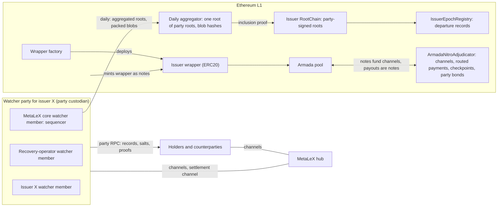
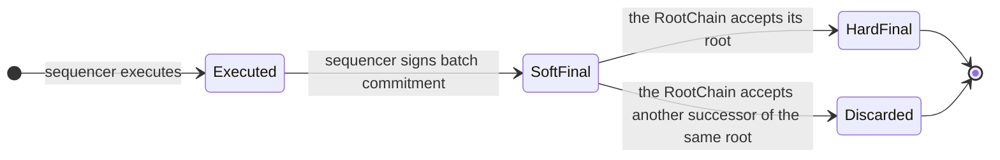

# MetaLeX on Armada: system design

Status: draft for review, 2026-11-09. Not built.

MetaLeX's Cybercorps contracts run unchanged in one issuer state per issuer. The issuer's watcher party executes that state and anchors it to Ethereum L1 through the issuer's RootChain. The watcher party is also an ordinary armada-nitro participant. Value stays in armada-nitro: shielded notes in the Armada pool, and channels funded from notes. A buyer's USDC stays in the buyer's channel until the watcher party countersigns the payment at settlement. Scrip leaves the issuer state as notes of the issuer's wrapper token. `invariants.md` lists the requirements that this document holds. Terms follow `glossary.md`.

## 0. Sources

| Key | Source |
|---|---|
| `mlx` | MetaLeX Engineering, *Build MetaLeX's private chain with recovery*, standalone edition, evidence as of 8 November 2026. Cited by section and table. |
| `review` | `invariant-review.md`: Armada's review of `mlx`. No contradictions, three open points. |
| `cc` | [`MetaLex-Tech/cybercorps-contracts`](https://github.com/MetaLex-Tech/cybercorps-contracts) at `8789081be696cc334f9b7b193b3c3eba17c8122b`, the commit that `mlx` analyses. Cited by file and line. |
| `nitro` | armada-nitro at `295b6c2e`. Cited by file and line. |
| `adr` | Armada `engineering/09-architecture-decisions.md`, including ADR-0021 |
| `p15` | Armada `engineering/15-hub-yield-and-swaps.md`: invariants I1–I7 of hub channels |
| `t2` | Armada `engineering/T2-watcher-substrate.md` and `glossary.md`: watcher parties |
| `nimbus` | [`status-im/nimbus-eth1`](https://github.com/status-im/nimbus-eth1): the nimbus EVM (`execution_chain/evm/`) and the verified proxy. Armada builds from its fork `AFDudley/nimbus-eth1`. |
| `zos` | [`matter-labs/zksync-os-zisk`](https://github.com/matter-labs/zksync-os-zisk): a REVM state transition proven with ZisK |

## 1. Requirements

1. Run the unchanged Cybercorps contracts (I-1 to I-3, R-1).
2. Keep each issuer's records readable only by MetaLeX, the recovery operator and the issuer (I-34, I-35).
3. Let a holder prove its own MetaLeX assets against L1, and help itself if the issuer, MetaLeX and the recovery operator all fail (R-15).
4. Keep all value in armada-nitro: shielded notes and channels (R-5, R-14).
5. Let scrip leave the issuer state as armada-nitro notes, with MetaLeX's accounting (I-17 to I-33).
6. Define every component as a typed state machine with guarded transitions. No fallback paths (R-12).
7. Let no party other than an asset holder start an action against that holder's assets (R-11).

## 2. Architecture

| Component | What it is |
|---|---|
| **Issuer RootChain** | An L1 contract, one per issuer. It stores the hard-final roots of the issuer state, one successor per root, each accepted on the party signature (§6). |
| **Daily aggregator** | An L1 contract. Once per day it records one Merkle root over every party's signed root, and the hashes of the blobs that carry their data (§6.2). |
| **Issuer state** | One EVM state per issuer: its Cybercorps companies, its payment token, its commit records and its payout records (§3) |
| **Watcher party** | An entity: the threshold signer that runs one issuer state and anchors it to L1 (R-27). Through its custodian it is also an armada-nitro participant and the minter of the issuer's wrapper (§4). |
| **Party custodian** | The watcher party's `HubCustodian`. It signs the watcher party's channel states and wrapper mints with the party key only, with no hot delegate (§4.1). |
| **Payment token** | The ERC20 that the Cybercorps contracts pull in the issuer state. Each unit is backed by an open commitment or by the watcher party's allocation in its settlement channel (§9.2). |
| **Settlement channel** | The watcher party's channel with the MetaLeX hub, an ordinary Nitro channel. Settled payments move into it, and pay-outs leave from it. Its latest co-signed state goes into each day's blob data (§9.2). |
| **Verifier tool** | A tool that reads the roots, the blobs and the adjudicator from L1, so that any third party can check the conservation proof's inputs itself (§11) |
| **MetaLeX hub** | An armada-nitro hub, and an entity distinct from MetaLeX, the company (R-27). As MetaLeX core it is a watcher member of every party (R-6). MetaLeX is a plaintext audience through it (R-36). It routes payments, runs watchtowers for website users, and supplies user IDs to each issuer state (§8.1, §9). |
| **Issuer wrapper** | An ERC20 on L1, one per issuer, whose only minter is the party custodian. It is held as notes in the Armada pool (§10). |
| **Wrapper factory** | The L1 factory that deploys each issuer's wrapper. A hub names it in its asset list (§10). |
| **Party RPC** | The watcher party's own private RPC, in MetaLeX's sense. The only interface to the issuer state (§8.1). |
| **Party bond** | One armada-nitro channel per watcher party (§4.4) |
| **IssuerEpochRegistry** | An L1 contract that records each departure: the old RootChain's final root and the successor's identity (§5.5) |

## 3. Issuer state

**Contents.** One EVM state per issuer holds the issuer's Cybercorps companies: CyberCorp, BorgAuth, IssuanceManager, LETs, scrip, agreements, deals, rounds, LexScrow and MetaVesT. It also holds the payment token, the commit records and the payout records (§9). Every asset in it is one that the issuer's watcher party issues. The USDC behind the payment token stays in armada-nitro.

**Which companies share one state.** `ParentCoFactory.deployCorp` deploys a CyberCorp. `ParentCoFactory.deployCorpContractFor` deploys a CyberCorp and signs its agreements in the same transaction (`cc` `src/ParentCoFactory.sol`). Which companies share one issuer state is a deployment parameter, to be settled with MetaLeX.

**Execution.** Each watcher member runs the state in the nimbus EVM, embedded in its harness, from one pinned commit of Armada's nimbus-eth1 fork (`nimbus`). The harness fixes these values:

| Value | Rule |
|---|---|
| `chainid` | Unique per issuer, never used by a public chain. EIP-712 domains therefore never collide (I-4). |
| Hardfork and precompiles | One pinned spec that matches MetaLeX's compiler target (I-3) |
| `timestamp` | Set by the sequencer, bounded by the timestamp of a recent L1 block. Cybercorps reads it for expiries, deadlines and holding periods. |
| `number`, `prevrandao`, `coinbase`, `basefee`, `BLOCKHASH` | Fixed by the harness. Cybercorps reads none of them: `src/` reads only `block.timestamp` and `block.chainid` (`cc`). |

**Why the nimbus EVM.** Armada's client already runs nimbus on every target. The verified proxy builds natively, as `libverifproxy.a` for iOS and Android, and as WASM (`adr` ADR-0009). The nimbus EVM is Nim in the same codebase. So the harness, the mobile app's watcher and the browser verifier run one EVM and one runtime, beside the light client they already contain. The nimbus EVM executes against an in-memory ledger, as the verified proxy's `eth_call` does (`nimbus` `execution_chain/evm/async_evm.nim`).

**State tree.** The harness does not use nimbus's own Merkle Patricia trie for the root. After each block it reads the changed slots from the ledger and commits the state in a Jellyfish Merkle Tree (JMT). A JMT is a 256-bit binary sparse Merkle tree in which empty and single-leaf subtrees collapse, so a proof has about log₂(number of keys) hashes. It proves inclusion and non-inclusion. The tree is blinded:

| Part | Rule |
|---|---|
| Position | `H(positionSalt ‖ address ‖ slot)`. The position salt is fixed per slot. |
| Leaf | `H(value ‖ salt)`, with a fresh random salt each time the value changes |
| Hash | Pluggable per deployment. Default SHA-256 (§14). |

**Events.** Besides the state root, each batch commits to `eventsRoot`: every log of the batch, in order. It is the same commitment as Ethereum's `receiptsRoot` and Starknet's `event_commitment`. Holders read their history from it (§8).

## 4. Watcher parties

A watcher party is "a bonded federation of service providers serving one data need, and here also the execution venue" (`t2`, Armada's glossary). On the money side it provides "netting + non-custodial settlement … over Nitro channels" (`t2`, "Clearing (Nitro)"). No watcher party exists yet: "No bonding, no DKG ceremony, and no signer set exist" (`t2`, T2.4).

### 4.1 Composition

| Rule | Value |
|---|---|
| Parties | One watcher party per issuer. MetaLeX's whole platform is the set of these parties (R-2). |
| Watcher members | MetaLeX core, the recovery operator, the issuer (n = 3) |
| MetaLeX core | The MetaLeX hub in its role as a watcher member of every party (R-6). The default sequencer. MetaLeX is a plaintext audience through it (I-35, R-36). |
| Party key | One FROST threshold key per party. The threshold t is a two-thirds majority of n, a parameter of the deployment. With n = 3, t = 2, and no signing set needs MetaLeX's share (R-38). |
| Party custodian | `HubCustodian` under the party key: the watcher party's EIP-1271 identity in its channels and the wrapper's minter (`nitro` `src/HubCustodian.sol`; `adr` ADR-0016 D16.2). It signs every channel state with the party key. It has no hot delegate, because roots finalize daily and a threshold signature per state costs no time that matters (R-34). |
| Sequencing key | Each watcher member's key for soft-final signatures, pinned in the RootChain |

**Liveness.** The system's liveness never depends on the MetaLeX hub: any t watcher members continue the RootChain and the pay-outs without it. With n = 3 and MetaLeX core down, an issuer's RootChain advances only while that issuer's watcher member is up (R-6, R-38).

### 4.2 Duties

1. **Sequence and execute** the issuer state. MetaLeX core does this by default.
2. **Sign hard-final roots** with the party key (§6). A watcher member contributes its signature share only after it stores the batch durably, so at least t watcher members hold every hard-final batch.
3. **Publish** each batch's blinded tree data in blobs (§7).
4. **Settle in its channels:** record commitments as payment token, countersign at settlement, publish the settlement channel's latest co-signed state, and pay out against burns (§9). Mint and burn the issuer's wrapper (§10).
5. **Publish a conservation proof** for each hard-final root (§11).
6. **Run the party RPC**, which serves each holder its records, salts and proofs (§8.1).

### 4.3 Storage

Each watcher member stores the full state and history itself: every block, receipt, log, salt and position salt. L1 does not rebuild a watcher member's state, because the blobs are blinded. A party continues as long as t of its watcher members hold the state.

### 4.4 Bond

Each party bonds through one armada-nitro channel. Its participants are the party custodian and a slashing arbiter. The arbiter is an EIP-1271 participant that signs only a state with a valid fault proof. So no one can slash the bond without such a proof. The watcher members fund the bond, and how they share a slash is their own agreement.

| Fault | Slashable | Proof |
|---|---|---|
| A sequencing key signs two different batch commitments with the same parent batch | Yes | Two signatures from that key |
| The party key signs two different successors of the same root | Yes | Two signatures from the party key, over two roots with the same `prevRoot` |
| A watcher member leaks plaintext | No | A leak does not identify the leaker. It stays a legal obligation. |

## 5. State machines

Each component is a typed state machine. Each target state has exactly one entry transition, with its guard. A transition whose guard fails reverts and changes nothing. There are no fallback paths (R-12).

### 5.1 Batch

| Transition | Guard |
|---|---|
| Executed → SoftFinal | The sequencer's pinned key signs the batch commitment |
| SoftFinal → HardFinal | The RootChain accepts the batch's root (§6.1) |
| SoftFinal → Discarded | The RootChain accepted a different successor of the same `prevRoot` |

Only a hard-final batch affects anything outside the issuer state. Such effects are a settlement, a pay-out, a wrapper mint, a departure, or a proof given to a holder as final.

### 5.2 RootChain

| State | Entry transition | Guard |
|---|---|---|
| Live | Deployment | — |
| Retired | `finalizeDeparture` on `IssuerEpochRegistry` (§5.5) | The RootChain is at its final root. It accepts no further roots (I-60). |

An issuer with no transactions posts nothing.

### 5.3 Payment

| State | Entry transition | Guard |
|---|---|---|
| Committed | The buyer signs a channel state that moves an amount of its allocation to the watcher party, and gives that state to the watcher party | The buyer's latest co-signed state allocates at least that amount to the buyer |
| Recorded | The watcher party writes a commit record (`channelId`, state hash, amount) and mints the same amount of payment token to the buyer | A Committed amount not yet recorded |
| Settled | In the batch whose root finalizes the step, the watcher party countersigns the committed state. A routed payment moves the amount into the settlement channel. The commit record closes. | That batch finalizes the step that pulled the payment token |
| Released | The buyer and the watcher party co-sign a later state that leaves the amount with the buyer. The commit record closes, and the payment token is burned. | The step is voided or refunded |
| Paid out | The holder burns payment token in a hard-final root. A routed payment moves the amount from the settlement channel to the holder. The watcher party writes a payout record (§9.2). | A Settled amount whose payment token the holder burned |

### 5.4 Scrip lock

| State | Entry transition | Guard |
|---|---|---|
| Locked | `lock` in the issuer state, naming the holder's note key | The entry guard: `canForceTransfer()`, `canForceBurn()` and `canFreeze()` all return false, `transferRestrictionHooksLength()` is zero, and the asset's implementation hash equals the pinned hash. CyberScrip's `disable…` functions are one-way: "Cannot be re-enabled post-initialization" (`cc` `src/CyberScrip.sol`). |
| Wrapped | The party custodian mints the same amount of wrapper and shields it as a note to the named key | The lock's batch is hard-final, and the lock is not yet wrapped |
| Returned | The holder pays wrapper back to the party custodian, which burns it | The token is the issuer's wrapper |
| Unlocked | The watcher party unlocks the scrip to the holder in the issuer state | A Returned amount not yet unlocked |

`setRestrictionHook` stays callable after a lock (`cc` `src/CyberScrip.sol:146-149`). A hook added later that blocks an unlock is a misaccounting, and the signed lock and return records are the holder's evidence (§11).

Each lock and return record binds the bindings of `mlx`'s `BridgeMessageV1`: issuer (`chainid`), epoch, direction, asset, holder, note key, amount, nonce and source event (I-28). `mlx` §2's six statuses map onto the states:

| `mlx` status | Here |
|---|---|
| submitted | The lock or return transaction is sent |
| included | The lock is in a batch |
| source-finalized | The lock's batch is hard-final |
| message-proven | Not used: no public gateway proves a message. The watcher party's signed mint or unlock record takes its place. |
| destination-executed | Wrapped (out) or Unlocked (in) |
| recovery-protected | The records are in the watcher members' stores and in the holder's own store |

### 5.5 Issuer epoch

| State | Entry transition | Guard |
|---|---|---|
| Active | Deployment | — |
| Retiring | `scheduleDeparture` on `IssuerEpochRegistry` | Signed by the party key. The successor's watcher party checks `mlx` §3's scope rules (settled deals, drained escrows, no reserved units, resolved allocations) before it accepts the state. |
| Retired | `finalizeDeparture` | Signed by the party key. It records the old RootChain's final root and the successor's identity, and the old RootChain accepts no further roots. |

No import happens on L1 (R-39). The successor's watcher party receives the full state from the old watcher members, the MetaLeX hub included. Each holder proves its own records to the successor from its own store, against the final root. Every wrapper note, pending lock or return, and open commitment gets one disposition in the successor's state (I-62).

## 6. RootChain rules

### 6.1 Root acceptance

The RootChain accepts a root, directly or by inclusion proof from the daily aggregator (§6.2), only if all of these hold:

1. **One successor.** `prevRoot` equals the last hard-final root, and `height` is the last height plus one.
2. **Party signature.** The party key signed `(prevRoot, newRoot, height, batchCommitment, eventsRoot, chainConfigHash, blobRefs)`.
3. **Blob binding.** `blobRefs` lists the versioned hashes of the blobs that carry this party's data, with its offset and length in each. Every hash is one that the aggregator recorded as published, or one in the root's own blob transaction.

The RootChain only stores roots. It checks no validity proof (§11) and acts on no message.

### 6.2 Daily aggregation (R-43)

By default, MetaLeX core publishes all parties' roots of the day in one run:

1. **Blobs, packed by size.** The blob data of every party with changes is concatenated and split into blobs. One blob transaction holds up to Ethereum's per-transaction blob limit; a day that needs more uses more blob transactions.
2. **One aggregation call.** The first blob transaction calls the aggregator. It records the versioned hashes of the day's blobs and one Merkle root over the day's signed party roots.
3. **Lazy RootChain reads.** A RootChain reads its root from the aggregator by inclusion proof only when an L1 action needs it, for example a departure. Holders check the inclusion proof off chain (§8.2).

Each party still signs only its own root and its own blob references. A party with no changes is absent from the day's tree, and posts nothing (R-17). Any t watcher members of a party may submit their root directly to their RootChain, in their own blob transaction, by the same rules. That is the same transition, not a second path.

## 7. Blob data: blinded, not encrypted

Each root publishes, in blobs, the blinded position and blinded leaf of every slot whose value changed since the previous root. The blobs also carry the watcher party's latest co-signed settlement-channel state (§9.2). A slot that changed several times since the previous root appears once, with its final value. Interior nodes are not published: anyone with the archived leaves rebuilds the tree.

| Property | Result |
|---|---|
| Binding | The party signature names the blob hashes, offsets and lengths (§6.1) |
| Hiding | No key exists to steal or break. Learning a value needs a SHA-256 preimage that includes a 256-bit random salt. |
| What stays visible | How many leaves changed per batch, when, and the size of the tree. A slot's position salt is fixed, so an observer can see that the same position changed again in a later batch. |
| Who uses it | A holder that lost its own copy of its records, salts and proofs, or that got no update for a root (§8.2, §8.3). The verifier tool (§11). |
| What it does not do | Rebuild a watcher member's state. Watcher members store the state themselves (§4.3). |

Ethereum prunes blobs after about 18 days. Every watcher member archives the blob data, and anyone else may archive it too, because it reveals nothing. Each holder keeps its records, salts and latest proofs. Most holders use MetaLeX's website, which keeps them in browser storage. Holders who want durable records use Armada's mobile app, which contains the website and a watcher for the holder's own records. Browser storage holds the same data, but it is more easily deleted (R-33).

## 8. Holders

### 8.1 The party RPC

Each watcher party runs its own RPC, in MetaLeX's sense of the word: the private, authenticated endpoint that `mlx` puts in front of the chain ("Private RPC/policy enforcement", Table 02). It is the only interface to the issuer state. Any watcher member may run an endpoint of it. MetaLeX core runs one by default.

For each hard-final batch that changes a holder's records, the party RPC gives the holder:
- each changed value, its new salt and its position salt;
- the logs that touch the holder's records;
- a proof of each record against the new root.

A holder subscribes for these, or fetches them. Every item verifies against a root on L1.

**Authentication (R-20, R-21).** The issuer state gets user IDs from the MetaLeX hub. A user signs each request to the party RPC with its wallet key, through MetaLeX's existing wallet login (`mlx` §4: the Privy-aware wallet abstraction). The party RPC checks the signature against the ID in the issuer state, and scopes the request by the contracts' authority for that address (§8.4). The hub is not in the request path, so a user reads its records while MetaLeX core is down. Authentication establishes identity only. Rights stay in the contracts (I-5, I-10).

### 8.2 Verification

1. **Read the root** from the RootChain through a light client: Armada's nimbus verified proxy.
2. **Check each record** with the JMT verifier from `lib/`, compiled to WASM with the nimbus toolchain: the same Nim code that the harness runs.
3. **Check the code.** The same root commits to each contract's code hash. The holder decodes slots with the storage layout that MetaLeX's deployment manifest pins for that code hash.
4. **Check completeness** of its history: every change of value between consecutive roots must be explained by logs in `eventsRoot`.
5. **Check every new root.** The verifier checks each of the holder's records against each new hard-final root. If a proof fails and the party RPC delivered no update, the verifier reads that root's blobs to find the change (§7). The mobile app does this itself. The website does it while it is open.

So a holder detects any change to its own records, even when the party RPC is silent. It can also prove what it held at any root.

### 8.3 Self-help

The issuer, MetaLeX and the recovery operator can all fail. A holder then uses only L1 and what it holds in browser storage or in the app (§7):
- its values, salts and position salts from §8.1;
- the archived blob data, from which it rebuilds the tree.

From these it computes a proof of each record against the last root. That proof shows what the holder owned. If the issuer departs to a successor, the holder proves its records to the successor's watcher party with the same proof, off L1 (§5.5).

### 8.4 Scope

A holder sees its own records under the contracts' own authority: its LETs, scrip, payment token, endorsements, agreements and grants. It sees an asset's history only from the batch in which it first holds the asset. Earlier holders are other counterparties of the issuer, and no counterparty sees another counterparty's private data (R-22). Issuer officers see every counterparty's data. MetaLeX, through the MetaLeX hub, and the recovery operator see everything, as the named plaintext audiences (I-35, R-36).

### 8.5 Methods and writes

The party RPC serves MetaLeX's app with `eth_sendRawTransaction`, `eth_getTransactionReceipt`, `eth_call` and `eth_getLogs`, each scoped by the contracts' authority (§8.4, `mlx` §4, A1). It adds methods for records, salts, proofs and history subscription. It has no unscoped method.

Writes go to the sequencer. Before sequencing, the harness executes each transaction with an inspector that checks every CALL, DELEGATECALL and CREATE frame against the policy (I-39). A transaction with a denied frame is not included.

The sequencer can also refuse a write. A payer whose write is refused gets no asset and has no remedy on L1. Its signed request and the refusal are its evidence to MetaLeX (R-40).

### 8.6 The web app's endpoint and indexing

MetaLeX's web app needs no new transport. The work splits between the party RPC and the browser:

| Part | Where it runs |
|---|---|
| A standard JSON-RPC endpoint for each issuer's `chainid`, so the app's contract calls stay unchanged | The party RPC, on the endpoints that watcher members run. The MetaLeX hub is not in the request path (R-21). |
| The watcher party's own index: logs, history and records, scoped by the contracts' authority | The party RPC. The app needs no public indexer. |
| The signature on each request (§8.1) | The browser, through the user's wallet |
| Verification of each record against the issuer's root on L1 (§8.2), failing closed when a check or the authentication fails (I-40) | The browser, through the WASM verifier and Armada's browser light client |

The app's one new step is the payment commitment, which the user's Armada wallet signs (§9.2).

## 9. Value

### 9.1 Where value lives (R-5, R-14)

All value is armada-nitro assets on L1: shielded notes in the Armada pool, and channels funded from notes that pay out to notes.

| Property | Source |
|---|---|
| A channel is funded from a note. The collateral stays in the pool as an adjudicator-owned commitment. | `nitro` `ArmadaNitroAdjudicator.depositFromNote`, `src/ArmadaNitroAdjudicator.sol:91` |
| A payout mints fresh SHIELD notes in the pool | `nitro` `src/ArmadaNitroAdjudicator.sol:144, 159` |
| No counterparty can take funds: every outcome needs the holder's latest signed state | ForceMove |
| A hub is trusted for liveness only | `adr` ADR-0015/0016, ADR-0021 |

Funding a channel needs a working hub: MetaLeX's or an issuer's (R-13).

**Watchtowers (R-37).** ForceMove protects a channel only if someone answers a stale-state challenge within the challenge window. The MetaLeX hub runs a watchtower for website users by default. The recovery operator may also run one. The mobile app runs its own.

### 9.2 The watcher party as a Nitro participant

The Cybercorps contracts pull, hold and pay an ERC20 in the same EVM (`cc` `src/storage/LexScrowStorage.sol:251, 308`). In the issuer state that ERC20 is the payment token. The watcher party connects it to armada-nitro through its own channels (R-24). No contract and no app reads an issuer root to move USDC: the signatures are binding (R-26, R-35).

| Part | Rule |
|---|---|
| Buyer channels | Each buyer has a channel with the watcher party, funded through the hub (§9.3). The party custodian is the watcher party's participant. |
| Commit | To pay in, the buyer signs a channel state that moves the amount to the watcher party, and gives it to the watcher party. The USDC stays in the buyer's channel. The watcher party writes a commit record and mints the same amount of payment token to the buyer. |
| Settle | In the batch whose root finalizes the step, the watcher party countersigns the committed state. A routed payment moves the amount into the settlement channel. Its signature on the root binds it to the shares; its signature on the state completes the payment. |
| The buyer cannot withdraw a commitment | If the buyer force-closes with an earlier state, the watcher party answers the challenge with the buyer-signed, higher-turn committed state. ForceMove's turn rule decides; no root is read. |
| Release | If the step is voided or refunded, the buyer and the watcher party co-sign a later state that leaves the amount with the buyer. The watcher party burns the payment token. |
| Settlement channel | The watcher party's channel with the MetaLeX hub. Settled amounts move into it, and pay-outs leave from it. |
| Publication (R-41) | Each day's blob data carries the settlement channel's latest co-signed state, bound by the party signature through `blobRefs` (§6.1). The channel itself works like any Nitro channel on the adjudicator: funding, challenge, checkpoint and conclusion as normal. |
| Pay out | A holder burns payment token. Against that burn in a hard-final root, a routed payment moves the amount from the settlement channel to the holder. |
| Payout record | With each pay-out, the issuer state records the `channelId` and the hash of the co-signed state that paid it. The holder's channel exit mints its note from that state, so the issuer's RootChain points to the note through the root (R-25). |
| Supply | Payment-token supply equals the open commit records plus the watcher party's allocation in the published settlement-channel state |
| Exit | ForceMove with the latest co-signed state, as in any channel |

### 9.3 Routed payments through the MetaLeX hub

Value moves between channels as one Nitro payment routed through the MetaLeX hub's channels. Nitro's guarantees and reclaim make the move atomic across the hops, and ForceMove accepts or rejects whole states (`adr` ADR-0021 D21.1). armada-nitro settles a reclaim in `_settleReclaimExit` (`src/ArmadaNitroAdjudicator.sol:192`); that code is being rewritten (§13). The hub routes the payment and advances no value. No hash lock is used, and no party has value in flight (R-30).

A user that does not want the MetaLeX hub uses an issuer's hub, or a channel with the watcher party directly.

### 9.4 A primary deal, step by step

1. **The issuer proposes.** An issuer officer calls `DealManager.proposeDeal(certPrinter, paymentToken, paymentAmount, …)` (`cc` `src/DealManager.sol:144`), with the payment token as `paymentToken`. The issuer state creates the agreement and an `Escrow` (`LexScrowStorage.sol:184`): `corpAssets` holds the LET, and `buyerAssets` holds the payment.
2. **The buyer commits payment.** The buyer's channel with the watcher party is funded through the MetaLeX hub. The buyer signs a state that moves the amount to the watcher party. The watcher party records the commitment and mints the payment token to the buyer (§9.2). The USDC stays in the buyer's channel.
3. **The buyer signs and pays.** `signDealAndPay` (`DealManager.sol:231`) pulls the payment token into LexScrow with `safeTransferFrom` (`LexScrowStorage.sol:251`). The escrow becomes `PAID`.
4. **The deal finalizes.** `finalizeDeal` (`DealManager.sol:271`) runs `finalizeEscrow` (`LexScrowStorage.sol:308`). It pays the payment token to `companyPayable()`, the issuer, and the fee to `getPlatformPayable()`, MetaLeX. It delivers the LET to the buyer, and legal title moves to the buyer that the latest endorsement names.
5. **The batch is anchored and the payment settles.** The watcher members store the batch and sign it with the party key. In the same batch, the watcher party countersigns the buyer's committed state, and the amount moves into the settlement channel. MetaLeX core publishes the root in the daily run (§6.2).
6. **The issuer is paid out.** The issuer burns its payment token. Against that burn in a hard-final root, a routed payment moves the amount from the settlement channel to the issuer. The issuer state records the payout record. The issuer's channel exit mints a note to the issuer's identity in the Armada pool. MetaLeX's fee leaves the same way.
7. **Void.** `refundVoidedDeal` (`DealManager.sol:310`) returns the payment token to the buyer. The buyer and the watcher party co-sign a release state, and the payment token is burned. The USDC never left the buyer's channel.

## 10. Scrip as armada-nitro notes (I-17 to I-33)

Scrip leaves the issuer state the way USDC enters it, in the opposite direction. Outside the issuer state it is a note of the issuer's wrapper, and it trades like any armada-nitro asset.

**Out.**
1. The holder locks canonical scrip in the issuer state and names its note key. The scrip is locked, not burned, because its ratio cannot change while canonical supply is above zero (I-18). The entry guard applies (§5.4, I-19).
2. Once the lock's batch is hard-final, the party custodian mints the same amount of wrapper and shields it as a note to the named key. The Armada pool accepts it, because its token policy is a blocklist: "any ERC-20 not blocklisted can be shielded" (Armada `engineering/T0-ethereum-anchor.md`).

**In.**
1. The holder pays wrapper back to the party custodian, which burns it.
2. The watcher party unlocks the scrip to the holder in the issuer state.

**In channels.** A hub lists the assets that its channels hold: "The set of tokens the hub has configured for this adjudicator's channels" (`nitro` `src/ArmadaNitroAdjudicator.sol:44`). The list screens out tokens whose balances change other than by transfer (`p15` I1), and it is fixed at deployment to keep governance off the settlement path. The list may name factories (`adr` ADR-0021 D21.2). A hub names the wrapper factory, so its channels accept every issuer's wrapper. Every such token is a plain ERC20 whose only minter is its party custodian, so it passes I1. The wrapper factory must therefore exist before the adjudicator that names it is deployed.

**Accounting.** `mlx`'s identities apply unchanged (I-24 to I-27): locked scrip K equals wrapper supply Q plus locks awaiting mint O plus returns awaiting unlock R. The lock and return records carry `BridgeMessageV1`'s bindings (§5.4, I-28).

**Transfer policy (I-20).** A wrapper note can be unshielded like any note. The wrapper then moves as a plain ERC20, and no private holder limit applies to it. A holder that returns wrapper to scrip does not inherit recertification eligibility (I-21).

## 11. Trust without the zkEVM

**Scope.** The zkEVM matters for completeness, but proving every root is a daily operating cost, so it is out of scope for this release (R-23). The RootChain therefore accepts each root on the party signature alone (§6.1).

**Every signed act is a binding commitment (R-26).** The watcher party signs the roots, the channel states and the wrapper mints. Each signature binds it to what it records. A root that pays the issuer y USDC also records the n shares that the buyer receives for it. The commitment stays binding even if the operators fail to account for it in a later root.

**What holds without the zkEVM:**

| Guarantee | Basis |
|---|---|
| Value in an armada-nitro channel is safe | ForceMove with the latest co-signed state needs no root, given a watchtower (§9.1) |
| No single watcher member can sign | The party key needs a two-thirds majority of shares (§4.1) |
| A holder detects any change to its own records | Its verifier checks every new root, and reads the blobs when no update arrives (§8.2) |
| A holder can prove what it held at any root | Inclusion proofs against signed roots (§8.3) |
| A counterparty keeps its claim | Its claim is the operators' own signature on the agreement and the roots |
| Anyone can check conservation | The conservation proof, below |

**Conservation proof (R-28).** For each hard-final root, the watcher party publishes a zero-knowledge proof that anyone can verify off chain. Each identity has a public input on L1, and the proof reveals only totals:

| Asset | Identity | Public input on L1 |
|---|---|---|
| Payment token | Payment-token supply equals the open commit records plus the watcher party's allocation in the settlement channel | The published settlement-channel state, checked against the adjudicator (§9.2) |
| Scrip | Locked scrip K equals wrapper supply Q plus locks awaiting mint O plus returns awaiting unlock R | The wrapper's `totalSupply()` |

**Verifier tool (R-44).** Any third party can check the inputs itself. The tool reads the party roots from the aggregator, the blobs, and the adjudicator. For each settlement channel, it makes three checks against the adjudicator:

- Both participants co-signed the published state.
- Its turn number is not below any state that the adjudicator holds for the channel.
- Its allocations do not exceed the channel's holdings.

It then checks the conservation proof against these inputs and the wrapper's supply.

The proof shows the state at a root, not the transition that produced it. Its construction is an implementation question. Each open commit record is backed by a buyer-signed state that the watcher party holds, so it is binding (§9.2).

**What t colluding watcher members can do,** for example the issuer and MetaLeX: sign a root that misaccounts. L1 does not reject it. Each such root is signed evidence against them:

| Misaccounting | Evidence the counterparty holds |
|---|---|
| A holder's LET or scrip is moved or voided without the holder's signature, or shares are issued that the contracts forbid | Its earlier proofs of what it held, and the signed roots that contradict them |
| Payment token is minted with no commitment behind it, or a holder's payment token is moved | The signed agreement, the signed roots and its inclusion proofs: the operators' commitment to deliver n shares for y USDC. A mint with nothing behind it also fails the conservation proof. |
| Wrapper is minted with no locked scrip, or a hook added after a lock blocks the unlock | The signed lock, mint and return records. A mint with no lock also fails the conservation proof. |

Misaccounting is limited to one issuer. It moves no value held in armada-nitro channels and notes.

**What the zkEVM adds: conservation enforced on L1.** With the zkEVM, each root carries a validity proof. The proof shows that the root follows from the previous root under the Cybercorps contracts. L1 then rejects a root that moves a holder's assets without the holder's transaction. Conservation that depends on channel states and on the wrapper on L1 still rests on the conservation proof. `zos` shows the technique: a REVM state transition proven with ZisK.

**If the zkEVM is added later:**
- **Proof system.** Armada has chosen RISC Zero for zkVM proofs. ZisK stays an option (R-7).
- **Same EVM.** The prover must prove the same EVM semantics that the harness runs. `zos` proves REVM, a different implementation from the nimbus EVM. Equivalence of the two is a condition of that migration.
- **Cost.** Running provers is a daily operating cost, which is why this design leaves the zkEVM out (R-23).
- **Migration.** A RootChain that requires proofs is a new deployment. An issuer moves to it through the departure of §5.5.

## 12. Failures as state transitions

| Event | Transition | Result |
|---|---|---|
| The issuer has no transactions | None | Nothing posted. Holders' proofs stay current. |
| MetaLeX core stops | None in RootChain | The issuer and the recovery operator sequence and submit by the same rules (§6.2). Users route through an issuer's hub. Value in channels is unaffected. |
| A hub refuses to route | None | The user uses another hub, or a channel with the watcher party directly. Value in its channel exits by ForceMove. |
| Fewer than t watcher members are live | No hard finality, no settlements, no pay-outs | Holders keep their proofs against the last root and can prove what they own (§8.3). Value in channels exits by ForceMove. Open commitments stay open. |
| The sequencer refuses a write | None | The payer gets no asset and has no L1 remedy. Its signed request and the refusal are its evidence to MetaLeX (§8.5). |
| A lock is never wrapped, or a return is never unlocked | None on L1 | A watcher-party duty. The signed lock and return records are the holder's evidence (§5.4). |
| t watcher members sign a misaccounting root | None on L1 | Holders detect it (§8.2), the conservation proof fails if supply is broken, and the signed root is evidence against the operators (§11) |
| The party key signs two successors of one root | None in RootChain | The RootChain accepts one successor per root. The party bond is slashed (§4.4). |

## 13. Dependencies

| Need | Status |
|---|---|
| `HubCustodian` signing channel states with the party key, with no hot delegate | A change to armada-nitro. Not built. |
| armada-nitro channels, `ConsensusApp`, guarantees and reclaim, checkpoints, `HubCustodian` | In code, but being rewritten from the Lean model on Armada's plan: the merged adjudicator code "has confirmed defects (… reclaim creates value …) and is replaced by the rewrite" (Armada's build plan) |
| A hub's asset list naming the wrapper factory (`adr` ADR-0021 D21.2) | A change to armada-nitro's asset list. Not built. The wrapper factory must be deployed first. |
| Hub role, channels over Waku, watchtower | On Armada's plan. Next. |
| Wrapper factory and issuer wrapper ERC20 | New. Not built. |
| Issuer RootChain, daily aggregator and IssuerEpochRegistry | New. Not built. |
| Watcher-party harness: nimbus EVM, JMT, packed blobs, party RPC, commit and payout records | New. Not built. |
| nimbus in a browser | The WASM build of the verified proxy compiles, but stalls at its first `sync()` call; the cause is not known (`adr` ADR-0009 D9.2). The browser verifier depends on the fix. On Armada's plan. |
| Conservation proof | New. Construction not chosen. |
| Verifier tool | New. Not built. |
| Federation and party DKG: one FROST key per watcher party | On Armada's plan. Later. |
| Registry and bond, fault verifier | On Armada's plan. Later. |

## 14. Hash function choice and cost

### 14.1 The hash is a deployment parameter (R-8)

- `lib/` builds the state tree and the events tree over a hash parameter. The harness and the WASM holder verifier use the same code. `lib/` is Armada's own Nim implementation of the JMT, so it takes the hash as a parameter.
- The choice is fixed per deployment. The hash identities are part of `chainConfigHash`, so each accepted root states its hashes.
- Changing the hash of a live RootChain means a new RootChain, through the departure of §5.5.
- L1 verifies no tree proof. A departure imports off L1 (§5.5).

### 14.2 Measured cost

Measured on 2026-11-09:

- L1 gas: a Foundry test of one binary Merkle inclusion proof per hash.
- Browser time: Bun with `hash-wasm` and `@noble/hashes`.
- Native time: the Rust `sha2` and `sha3` crates.

The harness is Nim, so its native hash times are not yet measured.

| Cost | SHA-256 | Keccak-256 |
|---|---|---|
| L1 gas per proof, depth 32 | 62,431 | 37,577 |
| Browser time per proof, depth 32 (WASM) | 0.030 ms | 0.082 ms |
| Native time per tree update, depth 32 | 2,350 ns | 9,242 ns |

SHA-256 is 2.7 to 3.9 times faster off chain. Through WebCrypto, SHA-256 measured 0.375 ms per depth-32 proof, because each call is asynchronous, so the verifier uses the WASM implementation. L1 checks no tree proof, so Keccak-256's lower gas does not matter. SHA-256 is therefore the default. The blinding salts (§3) use the state-tree hash.

The EVM computes keccak for the `KECCAK256` opcode and for every mapping slot key. That cost is the same for every tree hash.

### 14.3 Operating costs

`cost-comparison.md` prices these lines against MetaLeX's Prividium plan.

| Cost line | Driver |
|---|---|
| Hub channel capacity | Peak payment value being routed |
| People operating the watcher members' watchers | The number of parties and incidents. `mlx` assumed 40–80 hours per month for MetaLeX's own maintenance. |
| L1 settlement | One blob transaction per day, which also calls the aggregator. More blob transactions only on a day whose data exceeds one transaction's blob limit. Channel and wrapper transactions as users make them. |
| Blob data | Slots changed since the previous root × 64 bytes, plus one settlement-channel state per party. One blob costs 131,072 blob gas. |
| Proving | One conservation proof per root, off chain (§11). No zkEVM. |
